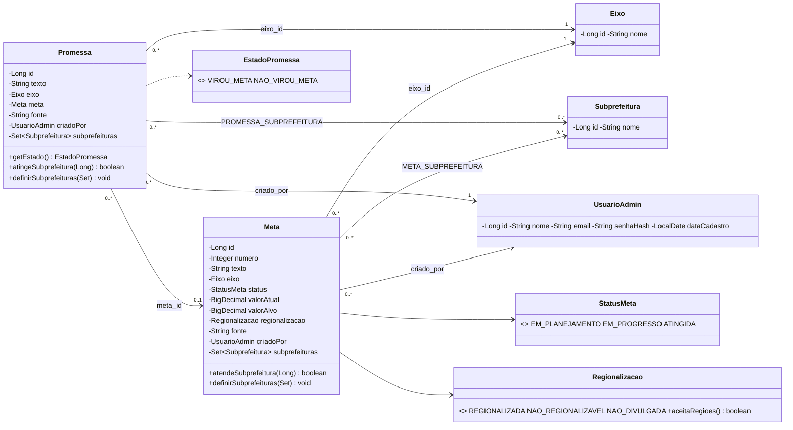
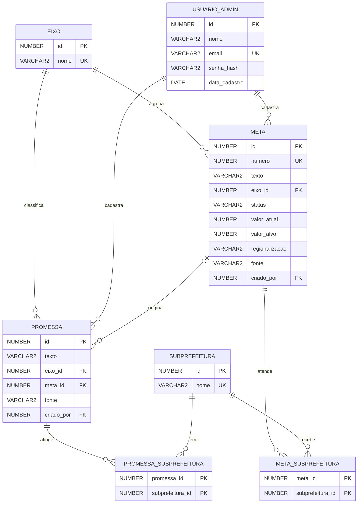

# Pra Todos SP — Documentação técnica (Java)

Base para o PDF da disciplina Domain Driven Design — Java. Tudo aqui reflete o código e o banco reais.
Fontes da verdade: `docs/INTEGRACAO.md` (contrato do grupo), `docs/exemplos/` (formato do JSON) e
`src/main/resources/db/01_ddl.sql` / `02_dml.sql` (banco do grupo).

## 1. Decisões e conformidade com o contrato do grupo

| # | Ponto | Decisão |
|---|---|---|
| 1 | Padrão de acesso a dados | JPA / Spring Data (confirmado pela equipe). Os DAOs são interfaces `JpaRepository`. |
| 2 | Banco | Modelo do grupo (versão alinhada ao Agile): 7 tabelas, ids fixos e sequences `SEQ_*.NEXTVAL` iguais ao `01_ddl.sql`. Novidades: `META.fonte`, `PROMESSA.fonte` e `PROMESSA.eixo_id` (área da promessa), todos obrigatórios. O mapeamento deve ser conferido com `ddl-auto=validate` no Oracle FIAP. |
| 3 | Rotas e JSON | Exatamente as do `INTEGRACAO.md`. O JSON real foi comparado campo a campo com `docs/exemplos/` (termômetro de Itaquera, termômetro de todas, promessas, metas e o CSV): **idênticos**. |
| 4 | Percentual | Não é coluna: `MetaBO.calcularPercentual` = atual ÷ alvo × 100 com 1 casa (8/30 = 26.7); `null` sem valor alvo. |
| 5 | Região das promessas | Com meta → região da meta (`META_SUBPREFEITURA`); sem meta → `PROMESSA_SUBPREFEITURA`. Promessa cuja meta não tem região não aparece em nenhum bairro (como no exemplo). |
| 6 | Proteção das rotas | JWT + BCrypt (Spring Security). GET e `POST /login` públicos; demais POST/PUT/DELETE exigem admin. `POST /admins` também exige login (decisão da equipe); o primeiro admin vem de `ADMIN_EMAIL`/`ADMIN_PASSWORD`, porque os admins do `02_dml` têm senha fictícia. |
| 7 | `criado_por` | Preenchido com o admin do token; nunca aparece no JSON. |
| 8 | Fonte (US05 do Agile) | Cada meta e cada promessa guarda a sua `fonte` (obrigatória, até 200 caracteres) e a tela mostra esse valor. |
| 9 | Rótulos de status | Na tela, os do Agile (Em planejamento / Em andamento / Concluída), sempre com ícone + texto + cor. No JSON, os códigos do banco. |
| 10 | Filtro por área (US12) | Cada promessa tem área (`eixo_id`). Na tela do bairro o filtro por área funciona no navegador, sem rota nova. Promessa com meta deve ter a mesma área da meta (regra no `PromessaBO`). |
| 11 | Rotas extras | `GET /promessas/{id}` (detalhe da Tela 3 e edição no admin). Não muda nenhum formato do contrato. |
| 12 | Testes e banco | Nenhum H2. Unitários com DAOs simulados (Mockito); `OracleIntegracaoIT` no Oracle real com rollback. |

## 2. Arquitetura

```
Navegador / Python  ──HTTP/JSON──►  CONTROLLER  ──►  BO  ──►  DAO  ──JDBC──►  Oracle FIAP
                                        │            │
                          JwtAuthFilter + CORS      GlobalExceptionHandler (erros em JSON)
```

| Camada | Pacote | Responsabilidade |
|---|---|---|
| MODEL | `model` | Entidades JPA das tabelas do `01_ddl.sql` (`Eixo`, `Subprefeitura`, `Meta`, `Promessa`, `UsuarioAdmin`); as tabelas de ligação viram `Set<Subprefeitura>` em `Meta` e `Promessa`. Enums `StatusMeta`, `Regionalizacao`, `EstadoPromessa`. |
| DAO | `dao` | Interfaces Spring Data JPA; `@EntityGraph` evita N+1 consultas. |
| BO | `bo` | Regras: valores, regionalização, percentual, ligações, termômetro, e-mail único, BCrypt, `criado_por`. |
| CONTROLLER | `controller` | Rotas do contrato, `@Valid`, códigos HTTP. Sem regra de negócio. |
| DTO | `dto` | Records no formato exato dos exemplos do grupo. Hash de senha e `criado_por` nunca saem. |
| EXCEPTION | `exception` | `RegraNegocioException` (400), `CredenciaisInvalidasException` (401), `RecursoNaoEncontradoException` (404), `ConflitoException` (409) + `GlobalExceptionHandler`. |
| SECURITY | `security` | `SecurityConfig` (regras + CORS), `JwtService`, `JwtAuthFilter`, `ErroSegurancaHandler` (401/403 em JSON). |
| CONFIG | `config` | Swagger e inicialização (scripts do grupo se o banco estiver vazio; primeiro admin). |

## 3. Regras de negócio (onde estão)

| Regra (INTEGRACAO.md) | Implementação | HTTP |
|---|---|---|
| `valor_atual` e `valor_alvo` juntos ou nenhum | `MetaBO.validarValores` + `CK_META_VALORES` | 400 |
| `valor_alvo` > 0; `valor_atual` ≥ 0 | `@Positive`/`@PositiveOrZero` + `MetaBO.validarValores` | 400 |
| REGIONALIZADA com ≥ 1 subprefeitura; as outras sem ligação | `MetaBO.validarRegionalizacao`, `ligarSubprefeitura`, `desligarSubprefeitura` | 400 / 409 |
| Ligar promessa a subprefeitura só se não tiver meta | `PromessaBO.ligarSubprefeitura` e `aplicarDados` | 409 |
| Ligar promessa a meta apaga as ligações dela | `PromessaBO.aplicarDados` | — |
| Apagar meta com promessas | `MetaBO.excluir` (ligações com subprefeituras são desfeitas antes) | 409 |
| E-mail de admin único; senha só em hash | `AdminBO.criar` + BCrypt | 409 |
| `criado_por` = admin logado | `MetaBO.cadastrar`, `PromessaBO.cadastrar` | — |
| Número de meta único | `MetaBO` + `UK_META_NUMERO` | 409 |
| IDs inexistentes | caminho → 404; corpo (meta, eixo, subprefeituras) → 400 | 404 / 400 |
| Percentual | `MetaBO.calcularPercentual` | — |

## 4. Diagrama de classes (código real)

```mermaid
classDiagram
    direction TB
    class SubprefeituraController { +listar() +termometro(Long) +termometroTodas() }
    class EixoController { +listar() }
    class MetaController { +listar(Long, StatusMeta, Long) +exportar() +buscar(Long) +cadastrar(MetaRequest, Authentication) +atualizar(Long, MetaRequest) +excluir(Long) +ligar(Long, Long) +desligar(Long, Long) }
    class PromessaController { +listar(Boolean, Long) +buscar(Long) +cadastrar(PromessaRequest, Authentication) +atualizar(Long, PromessaRequest) +excluir(Long) +ligar(Long, Long) +desligar(Long, Long) }
    class AdminController { +login(LoginRequest) +criar(AdminRequest) }
    class TermometroBO { +daSubprefeitura(Long) +todas() }
    class MetaBO { +listar() +buscar() +exportarCsv() +cadastrar() +atualizar() +excluir() +ligarSubprefeitura() +desligarSubprefeitura() +calcularPercentual(BigDecimal, BigDecimal)$ +paraResumo(Meta)$ +paraResponse(Meta)$ }
    class PromessaBO { +listar() +buscar() +cadastrar() +atualizar() +excluir() +ligarSubprefeitura() +desligarSubprefeitura() +paraResponse(Promessa)$ }
    class SubprefeituraBO { +listar() +buscarEntidade() +buscarReferencias() }
    class EixoBO { +listar() +buscarReferencia() }
    class AdminBO { +autenticar() +criar() +buscarEntidadePorEmail() +criarAdminInicialSeNecessario() }
    class PromessaDAO { <<interface>> +findAllByOrderByIdAsc() +findWithDetalhesById(Long) +countByMetaId(Long) }
    class MetaDAO { <<interface>> +findAllByOrderByNumeroAsc() +existsByNumero(Integer) +existsByNumeroAndIdNot(Integer, Long) }
    class SubprefeituraDAO { <<interface>> +findAllByOrderByNomeAsc() +findAllByOrderByIdAsc() }
    class EixoDAO { <<interface>> +findAllByOrderByIdAsc() }
    class UsuarioAdminDAO { <<interface>> +findByEmail(String) +existsByEmail(String) }
    SubprefeituraController --> SubprefeituraBO
    SubprefeituraController --> TermometroBO
    EixoController --> EixoBO
    MetaController --> MetaBO
    PromessaController --> PromessaBO
    AdminController --> AdminBO
    TermometroBO --> PromessaDAO
    TermometroBO --> SubprefeituraDAO
    MetaBO --> MetaDAO
    MetaBO --> PromessaDAO
    MetaBO --> SubprefeituraBO
    MetaBO --> EixoBO
    MetaBO --> AdminBO
    PromessaBO --> PromessaDAO
    PromessaBO --> MetaDAO
    PromessaBO --> SubprefeituraBO
    PromessaBO --> AdminBO
    SubprefeituraBO --> SubprefeituraDAO
    EixoBO --> EixoDAO
    AdminBO --> UsuarioAdminDAO
```





## 5. DER (banco do grupo, `01_ddl.sql`)

Use também o diagrama exportado do Oracle Data Modeler pelo colega de Database.



## 6. Rastreabilidade

| História | UC | Endpoint | Classe | Teste |
|---|---|---|---|---|
| US01 Escolher bairro | UC01 | `GET /subprefeituras` | `SubprefeituraController`, `SubprefeituraBO` | `SubprefeituraControllerTest.listar` |
| US02 Promessas do bairro | UC02 | `GET /subprefeituras/{id}/termometro`, `GET /termometro` | `TermometroBO` | `TermometroBOTest.*`; `OracleIntegracaoIT.termometroItaquera`, `contagens` |
| US03 Virou meta? | UC03 | `GET /promessas?semMeta=` | `Promessa.getEstado`, `PromessaBO.listar` | `ModelTest.estadoDaPromessa`; `PromessaBOTest.listarTodas`, `filtros` |
| US04 Status e resultado | UC04 | `GET /metas/{id}`, `GET /metas` | `MetaBO.calcularPercentual` | `MetaBOTest.percentual`, `percentualNulo`; `MetaControllerTest.buscar` |
| US05 Fontes | UC04 | campo `fonte` em `/metas`, `/promessas` | `MetaBO.fonteObrigatoria`, `PromessaBO` | `MetaBOTest.*`, `PromessaBOTest.*` (fonte obrigatória); prints `tela3_*` |
| US06 Aviso de regionalização | UC06 | `GET /metas/{id}` (`regionalizacao`) | `MetaBO.validarRegionalizacao` | `MetaBOTest.regionalizacao`, `ligar`, `desligar` |
| US07 Acessibilidade | todos | — | `static/css/estilo.css`, `comum.js` (ícone + texto + cor) | prints `docs/prints/` |
| US08 Login admin | UC07 | `POST /login`, `POST /admins` | `AdminBO`, `JwtService`, `SecurityConfig` | `AdminBOTest.*`; `AdminControllerTest.*`; `PromessaControllerTest.seguranca` |
| US09 Gerenciar promessas | UC08 | `POST/PUT/DELETE /promessas`, ligações | `PromessaBO` | `PromessaBOTest.*`; `PromessaControllerTest.*` |
| US10 Gerenciar metas | UC09, UC11 | `POST/PUT/DELETE /metas`, `/metas/{id}/subprefeituras/{subId}` | `MetaBO` | `MetaBOTest.*`; `MetaControllerTest.*`; `OracleIntegracaoIT.fluxoCompleto` |
| US11 Vincular promessa a meta | UC10 | `PUT /promessas/{id}` (`metaId`) | `PromessaBO.aplicarDados` | `PromessaBOTest.ligarAMetaApagaLigacoes`, `desligarMeta`; `OracleIntegracaoIT.fluxoCompleto` |
| Exceções | — | todos | `GlobalExceptionHandler`, `ErroSegurancaHandler` | `PromessaControllerTest.erros` (404/400), `seguranca` (401/403), `erroInesperado` (500); `MetaControllerTest.cadastrar` (409) |

## 7. Telas (capturas reais em `docs/prints/`)

| Tela do Agile | Arquivo | Rota | Captura |
|---|---|---|---|
| Tela 1 — Escolha do bairro | `index.html` + `js/app.js` | `/#/` | `tela1_escolha_bairro.png` |
| Tela 2 — Promessas do bairro (termômetro) | idem | `/#/bairro/{id}` | `tela2_termometro_itaquera.png` |
| Tela 3 — Detalhe da promessa e da meta | idem | `/#/promessa/{id}` | `tela3_detalhe_meta_regionalizada.png`, `tela3b_detalhe_regiao_nao_divulgada.png`, `tela3c_detalhe_sem_meta.png` |
| Tela 4 — Administrador | `admin.html` + `js/admin.js` | `/admin.html` | `tela4a_login_admin.png`, `tela4b_cadastro_promessa.png`, `tela4c_gerenciar_metas.png` |

## 8. Resultados verificados

- Versão anterior ao alinhamento com o Agile (13/11/2026): `./mvnw verify` com 63 testes unitários/web + 3 de integração no Oracle real, todos passando.
- **A refazer após o alinhamento (campos `fonte` e `eixo_id`):** rodar `./mvnw verify`, recriar o esquema no Oracle (bloco DROP do `01_ddl.sql`, depois `01` e `02`), comparar o JSON com `docs/exemplos/` e refazer as capturas de tela. Preencha aqui o resultado.

## 9. Pendências

- [x] Ficha preenchida no README (Data Science ainda "a confirmar pelo grupo").
- [ ] Rodar `./mvnw verify`, recriar o Oracle com os novos SQLs, refazer prints (formulário do admin e telas do bairro) e testar o deploy.
- [x] GitHub: https://github.com/ArthurDev4/pra-todos-sp-java
- [x] Deploy: https://pratodossp.onrender.com (rotas testadas; JSON idêntico aos exemplos). Retestar após recriar o banco.
- [x] PDF gerado (`docs/Pra_Todos_SP_Documentacao_Java.pdf`); regerar com os links após GitHub e Render.
