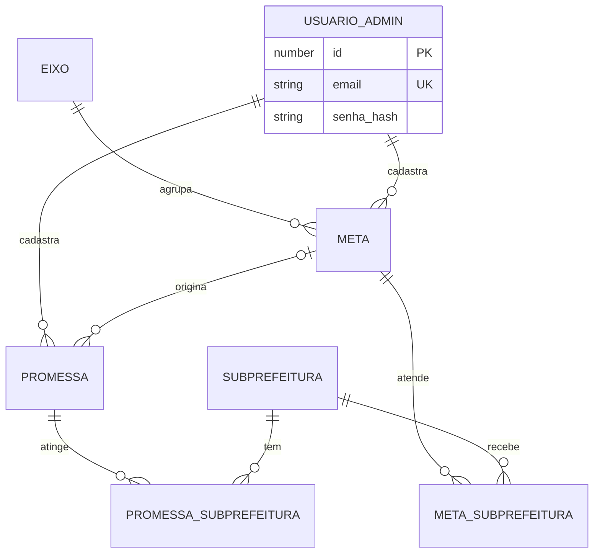

# Guia de integração: Banco Oracle ↔ API Java ↔ Python (grafo) ↔ Data Science

Projeto **Pra Todos SP** (CitizenTech, FIAP GS 2026.2, equipe Zynox). A funcionalidade principal é o termômetro de promessas por bairro.
Este guia é a fonte da verdade para a API Java. Os scripts `sql/01_ddl.sql`, `02_dml.sql` e `03_dql.sql` definem o banco: **não renomeie tabelas nem colunas** sem avisar o grupo.

```
 Oracle (7 tabelas) ──► API Java (Spring Boot) ──► JSON ──► Python (grafo de vizinhança + BFS)
                              │
                              └──► front-end: o cidadão escolhe o bairro e vê o termômetro
```

## 1. A ideia em 30 segundos
O cidadão de São Paulo escolhe o **bairro (subprefeitura)** e vê as **promessas** do prefeito (fictício) relacionadas à região. Cada promessa tem um estado: **virou meta oficial** (com status e, quando existir, o resultado numérico) ou **não virou meta**. Papéis: **Cidadão** (só consulta, sem login) e **Admin** (com login; cadastra e edita promessas e metas).

Todos os dados são **fictícios** (reais só os eixos e as subprefeituras). A tela e a documentação precisam mostrar o aviso **"dados fictícios"**.

## 2. Como subir o banco
1. No SQL Developer, conectado ao Oracle da FIAP, rode `01_ddl.sql`, depois `02_dml.sql`, depois `03_dql.sql`.
2. Os ids dos exemplos são fixos. As sequences `SEQ_<TABELA>` começam depois do último id: nos `INSERT` da API use `SEQ_META.NEXTVAL`, por exemplo. (`META_SUBPREFEITURA` e `PROMESSA_SUBPREFEITURA` não têm sequence: a chave é composta.)
3. Abra os scripts em UTF-8 (há acentos nos dados).
4. As senhas dos admins de exemplo são **fictícias** (hash inválido de propósito). Para testar o login, crie um admin novo por `POST /admins`.
5. Os scripts foram validados em um banco de teste equivalente, mas **ainda não rodaram no Oracle da FIAP**. Se algo falhar, avise o grupo com a mensagem de erro.

## 3. Tabelas e classes Java sugeridas
| Tabela | Classe | Observações |
|---|---|---|
| EIXO | Eixo | 4 linhas (Universo SP, Viver São Paulo, Cidade Empreendedora, Capital do Futuro) |
| SUBPREFEITURA | Subprefeitura | 7 subprefeituras reais de exemplo (Pinheiros é o bairro piloto do projeto) |
| META | Meta | `criado_por` (obrigatório) = id do admin que cadastrou. `status` e `regionalizacao` são enums (ver abaixo). `valor_atual` e `valor_alvo` são opcionais e vêm juntos. `fonte` é obrigatória (texto ou link, sempre mostrada na tela). O **percentual não é coluna**: calcule `valor_atual ÷ valor_alvo × 100` no BO |
| PROMESSA | Promessa | `meta_id` opcional: **vazio = "não virou meta"**. `eixo_id` obrigatório = a **área** da promessa (usada no filtro por área); se a promessa tem meta, o eixo precisa ser o mesmo da meta (regra do BO). `fonte` obrigatória (texto ou link, sempre mostrada na tela). `criado_por` (obrigatório) = id do admin que cadastrou |
| META_SUBPREFEITURA | (ligação) | Muitos para muitos entre Meta e Subprefeitura; chave primária composta |
| PROMESSA_SUBPREFEITURA | (ligação) | Muitos para muitos entre Promessa e Subprefeitura, **só para promessas sem meta**; chave primária composta |
| USUARIO_ADMIN | UsuarioAdmin | `senha_hash` BCrypt. **Nunca devolva o hash no JSON** |

Enums (guardados como texto no banco):
- `status`: `EM_PLANEJAMENTO`, `EM_PROGRESSO`, `ATINGIDA` (a tela mostra "Em planejamento", "Em andamento" e "Concluída", como no protótipo do Agile). Promessa sem meta aparece como "Não entrou no plano".
- `regionalizacao`: `REGIONALIZADA` (tem subprefeituras em META_SUBPREFEITURA), `NAO_REGIONALIZAVEL`, `NAO_DIVULGADA` (a tela mostra "regionalização ainda não divulgada"). Meta sem ligação é exibida como **"sem região definida"**.

Mapeamentos: `NUMBER(n,2)` ↔ `BigDecimal`, `DATE` ↔ `LocalDate`, `NUMBER` de id ↔ `Long`.

## 4. Endpoints

### Públicos (o cidadão consulta, sem login)
| Método | Rota | Para quê |
|---|---|---|
| GET | `/subprefeituras` | Lista de bairros para o cidadão escolher |
| GET | `/subprefeituras/{id}/termometro` | **Tela principal.** Promessas da região com o estado de cada uma (formato na seção 5) |
| GET | `/termometro` | O mesmo para todas as subprefeituras, como lista de blocos iguais ao da seção 5 (exemplo em `exemplos/termometro_todas.json`) |
| GET | `/eixos` | Os 4 eixos (para filtro) |
| GET | `/metas?eixoId=&status=&subprefeituraId=` | Metas com filtros opcionais |
| GET | `/metas/{id}` | Uma meta com percentual e subprefeituras |
| GET | `/promessas?semMeta=true&eixoId=` | Promessas com `area`, `fonte`, `estado` e `meta` (por exemplo, só as que **não viraram meta**), formato em `exemplos/promessas.json`. O filtro `eixoId` usa a área da própria promessa (filtro por área da tela). |
| GET | `/promessas/{id}` | Uma promessa (mesmo formato) mais `subprefeituras`: as regiões afetadas (da meta, se virou meta; de `PROMESSA_SUBPREFEITURA`, se não virou). Usada na tela de detalhe |

### Admin (login)
| Método | Rota | Para quê |
|---|---|---|
| POST | `/login` | E-mail e senha; confere o hash BCrypt; erro 401 se errado |
| POST | `/admins` | Cria um admin (o Java gera o hash BCrypt) |
| POST / PUT / DELETE | `/promessas`, `/promessas/{id}` | Cadastrar, editar e apagar promessas (corpo: `texto`, `eixoId`, `fonte` e `metaId` opcional) |
| POST / PUT / DELETE | `/metas`, `/metas/{id}` | Cadastrar, editar e apagar metas (corpo inclui `fonte`, `status` e `regionalizacao`) |
| POST / DELETE | `/metas/{id}/subprefeituras/{subId}` | Ligar e desligar uma meta de uma subprefeitura |
| POST / DELETE | `/promessas/{id}/subprefeituras/{subId}` | Ligar e desligar uma promessa **sem meta** de uma subprefeitura |

A GS exige GET, POST, PUT e DELETE no Controller: as rotas de promessas e metas cobrem os quatro.
Como proteger as rotas do Admin (token, sessão ou header simples) **depende do que foi ensinado em aula**: siga o padrão do professor.

### Regras no BO
- `valor_atual` e `valor_alvo` juntos ou nenhum; `valor_alvo` maior que 0; `valor_atual` não negativo.
- Meta `REGIONALIZADA` deve ter pelo menos uma subprefeitura ligada; `NAO_REGIONALIZAVEL` e `NAO_DIVULGADA` não devem ter ligação.
- Promessa com meta: o `eixo_id` da promessa deve ser igual ao da meta (400 se diferente). `fonte` obrigatória em meta e promessa.
- Ligar uma promessa a uma subprefeitura (`PROMESSA_SUBPREFEITURA`) só é permitido se a promessa **não tem meta** (409 se tiver); ao ligar uma promessa a uma meta, apague as ligações dela com subprefeituras.
- Apagar uma meta que tem promessas ou ligações: apague/desligue antes ou devolva erro claro (400 ou 409).
- E-mail de admin único; senha nunca em texto.
- Todo cadastro de meta ou promessa grava `criado_por` com o id do admin logado (a rota precisa saber quem é: o padrão de proteção de rotas da aula, ou, se for simples, o id do admin enviado no corpo/cabeçalho). Admin que cadastrou meta ou promessa não pode ser apagado (409). `criado_por` não aparece no JSON público do termômetro.
- Erros em JSON, com 400 (dados inválidos), 401 (login), 404 (não encontrado) e 409 (conflito).
- CORS habilitado para o front-end.

## 5. Formato do JSON do termômetro
`GET /subprefeituras/1/termometro` (exemplo completo em `exemplos/termometro_itaquera.json`):
```json
{
  "aviso": "Dados fictícios",
  "subprefeitura": {"id": 1, "nome": "Itaquera"},
  "promessas": [
    {"id": 1, "texto": "Construir creches em todos os bairros", "area": "Universo SP",
     "fonte": "Plano de governo (fictício)", "estado": "VIROU_META",
     "meta": {"id": 1, "numero": 1, "texto": "Ampliar a rede de creches ...", "eixo": "Universo SP",
              "status": "EM_PROGRESSO", "valorAtual": 12, "valorAlvo": 40, "percentual": 30.0,
              "regionalizacao": "REGIONALIZADA", "fonte": "Programa de Metas (fictício)"}}
  ],
  "naoViraramMeta": [
    {"id": 11, "texto": "Fazer um grande parque linear na zona leste", "area": "Viver São Paulo",
     "fonte": "Plano de governo (fictício)", "estado": "NAO_VIROU_META", "meta": null}
  ]
}
```
- `area` é o eixo da própria promessa (`PROMESSA.eixo_id`); `fonte` vem de `PROMESSA.fonte` e, dentro da meta, de `META.fonte`.
- `percentual` é `null` quando a meta não tem `valorAlvo`.
- **Região das promessas:** a promessa que virou meta tem região **pela meta** (META_SUBPREFEITURA). A que **não** virou meta tem região pela tabela **PROMESSA_SUBPREFEITURA**. Por isso `naoViraramMeta` traz só as promessas sem meta ligadas àquela subprefeitura. Uma promessa sem meta e sem nenhuma ligação não aparece em nenhum bairro (nos dados de exemplo todas têm ligação).

### 5.1 Como as telas do Agile usam a API
| Tela do protótipo | Chamadas | Observações |
|---|---|---|
| 1. Escolha do bairro | `GET /subprefeituras` | Lista os 7 bairros (piloto: Pinheiros). Mostrar o aviso de dados fictícios |
| 2. Promessas do bairro | `GET /subprefeituras/{id}/termometro`; filtro por área no front (campo `area`) ou `GET /promessas?eixoId=` | Resumo no topo: quantas viraram meta (`promessas`) e quantas não entraram no plano (`naoViraramMeta`). Cada cartão mostra texto, estado e `fonte` |
| 3. Detalhe da promessa e da meta | `GET /promessas/{id}` e, se tiver meta, `GET /metas/{id}` | Barra de progresso com `percentual` (quando não é `null`); regiões afetadas em `subprefeituras`; aviso quando `regionalizacao` é `NAO_DIVULGADA` ("região ainda não divulgada") ou `NAO_REGIONALIZAVEL` ("região não definida"); link ou texto da `fonte` |
| 4. Administrador: cadastro | `POST /login`, `POST /promessas` (texto, área, fonte, meta opcional), `PUT`/`DELETE /promessas/{id}`; metas em `/metas` | Meta vazia significa que a promessa não entrou no plano |

Rótulos da tela (linguagem simples, sem "eixo" nem "regionalização"): `ATINGIDA` = "✔ Concluída"; `EM_PROGRESSO` = "◔ Em andamento"; `EM_PLANEJAMENTO` = "○ Em planejamento"; promessa sem meta = "– Não entrou no plano". Estado sempre com ícone, texto e cor juntos.

## 6. Contrato com o Python (Dynamic Programming)
O projeto Python (programa de terminal, já pronto) monta um grafo de vizinhança entre as subprefeituras (a vizinhança fica só no código Python) e, com BFS, mostra as promessas e metas do bairro escolhido e dos vizinhos. Ele só precisa **ler** uma rota:
- `GET /termometro`: lista com **um bloco por subprefeitura**, no mesmo formato de `GET /subprefeituras/{id}/termometro` (exemplo em `exemplos/termometro_todas.json`). Os nomes das subprefeituras precisam ser exatamente os do banco (a lista de vizinhança do Python usa esses nomes).

O programa aceita a URL: `TERMOMETRO=https://SUA-URL/termometro python app.py`. Sem a variável, usa dados de exemplo embutidos.

## 7. Data Science (opcional na API)
A proposta do grupo para Data Science é um dataset **real e não político**, com uma amostra de metas do Programa de Metas transcrita à mão (cerca de 30 a 40 metas). Ele **não depende da API**. Se quiserem aproveitar o formato, há `exemplos/metas_export.csv` (colunas: numero, eixo, status, valor_atual, valor_alvo, percentual, regionalizacao, qtd_subprefeituras, qtd_promessas) e a rota opcional `GET /metas/export` que devolve esse CSV. Com 12 metas fictícias não dá para treinar um modelo de verdade: é só um formato de exemplo.

## 8. Diagrama ER (Mermaid)

Use também o diagrama que o grupo exportar do Oracle Data Modeler para a sua documentação.

## 9. Combinados do grupo
1. Nomes de tabela, coluna e eixos/subprefeituras **exatamente** como no banco (com acento).
2. Ids fixos dos exemplos.
3. Dados sempre fictícios, com o aviso "dados fictícios" na tela e na documentação.
4. Senha só em hash BCrypt; nunca devolver o hash.
5. Mudou tabela, coluna ou formato de JSON? Avise o grupo antes.
