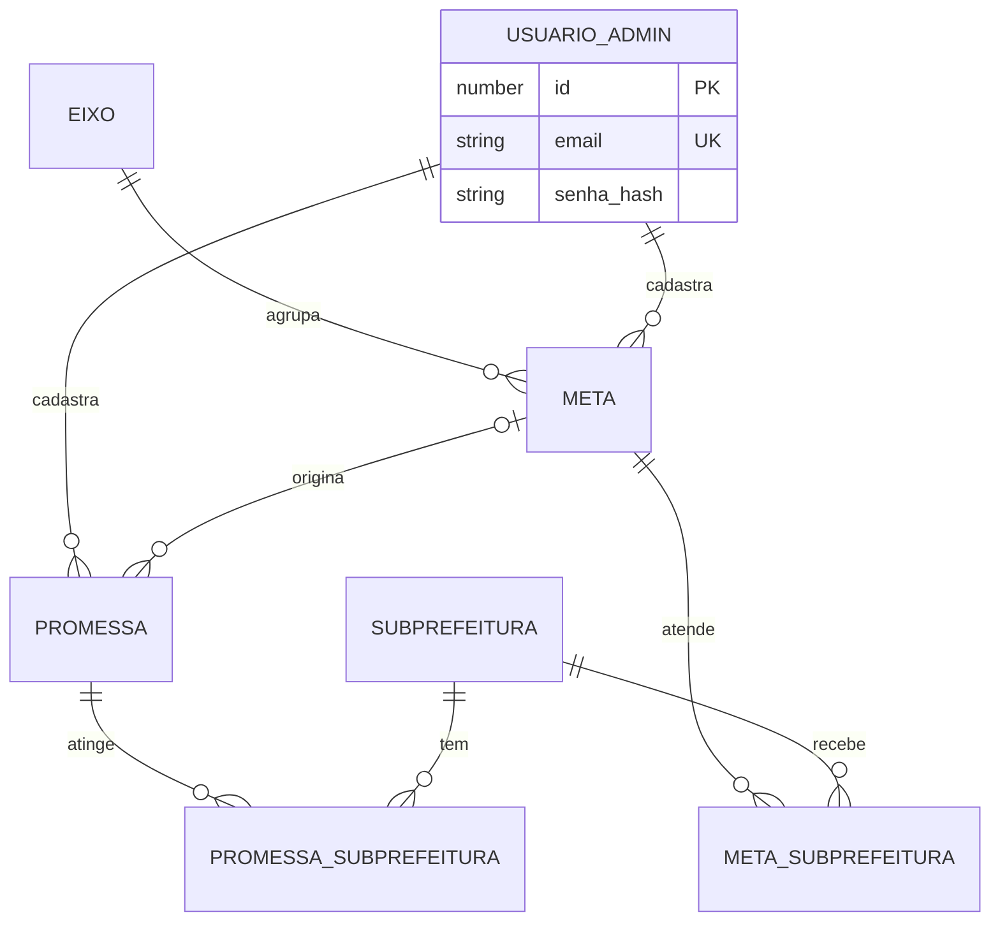

# Guia de integração: Banco Oracle ↔ API Java ↔ Python (busca) ↔ Data Science

Projeto **Pra Todos SP** (CitizenTech, FIAP GS 2026.2, equipe Zynox). A funcionalidade principal é o termômetro de promessas por bairro.
Este guia é a fonte da verdade para a API Java. Os scripts `sql/01_ddl.sql`, `02_dml.sql` e `03_dql.sql` definem o banco: **não renomeie tabelas nem colunas** sem avisar o grupo.

```
 Oracle (7 tabelas) ──► API Java (Spring Boot) ──► JSON ──► Python (busca de promessas, distância de edição)
                              │
                              └──► front-end: o cidadão escolhe o bairro e vê o termômetro
```

## 1. A ideia em 30 segundos
O cidadão de São Paulo escolhe o **bairro (subprefeitura)** e vê as **promessas** do prefeito (fictício) relacionadas à região. Cada promessa tem um estado: **virou meta oficial** (com status e, quando existir, o resultado numérico) ou **não virou meta**. Papéis: **Cidadão** (só consulta, sem login) e **Admin** (com login; cadastra e edita promessas e metas).

Todos os dados são **fictícios** (reais só os eixos e as subprefeituras). A tela e a documentação precisam mostrar o aviso **"dados fictícios"**.

## 2. Como subir o banco
1. No SQL Developer, conectado ao Oracle da FIAP, rode `01_ddl.sql`, depois `02_dml.sql`, depois `03_dql.sql`.
2. Os ids dos exemplos são fixos. As sequences `SEQ_<TABELA>` começam depois do último id: nos `INSERT` da API use `SEQ_META.NEXTVAL`, por exemplo. (`META_SUBPREFEITURA` e `PROMESSA_SUBPREFEITURA` não têm sequence: a chave é composta.)
3. Abra os scripts em UTF-8 (há acentos nos dados).
4. As senhas dos admins de exemplo são **fictícias** (hash inválido de propósito). Para testar o login, crie um admin novo por `POST /admins`.
5. Os scripts foram validados em um banco de teste equivalente, mas **ainda não rodaram no Oracle da FIAP**. Se algo falhar, avise o grupo com a mensagem de erro.

## 3. Tabelas e classes Java sugeridas
| Tabela | Classe | Observações |
|---|---|---|
| EIXO | Eixo | 4 linhas (Universo SP, Viver São Paulo, Cidade Empreendedora, Capital do Futuro) |
| SUBPREFEITURA | Subprefeitura | 6 subprefeituras reais de exemplo |
| META | Meta | `criado_por` (obrigatório) = id do admin que cadastrou. `status` e `regionalizacao` são enums (ver abaixo). `valor_atual` e `valor_alvo` são opcionais e vêm juntos. O **percentual não é coluna**: calcule `valor_atual ÷ valor_alvo × 100` no BO |
| PROMESSA | Promessa | `meta_id` opcional: **vazio = "não virou meta"**. `criado_por` (obrigatório) = id do admin que cadastrou |
| META_SUBPREFEITURA | (ligação) | Muitos para muitos entre Meta e Subprefeitura; chave primária composta |
| PROMESSA_SUBPREFEITURA | (ligação) | Muitos para muitos entre Promessa e Subprefeitura, **só para promessas sem meta**; chave primária composta |
| USUARIO_ADMIN | UsuarioAdmin | `senha_hash` BCrypt. **Nunca devolva o hash no JSON** |

Enums (guardados como texto no banco):
- `status`: `EM_PLANEJAMENTO`, `EM_PROGRESSO`, `ATINGIDA` (a tela mostra "Em planejamento", "Em progresso", "Atingida").
- `regionalizacao`: `REGIONALIZADA` (tem subprefeituras em META_SUBPREFEITURA), `NAO_REGIONALIZAVEL`, `NAO_DIVULGADA` (a tela mostra "regionalização ainda não divulgada"). Meta sem ligação é exibida como **"sem região definida"**.

Mapeamentos: `NUMBER(n,2)` ↔ `BigDecimal`, `DATE` ↔ `LocalDate`, `NUMBER` de id ↔ `Long`.

## 4. Endpoints

### Públicos (o cidadão consulta, sem login)
| Método | Rota | Para quê |
|---|---|---|
| GET | `/subprefeituras` | Lista de bairros para o cidadão escolher |
| GET | `/subprefeituras/{id}/termometro` | **Tela principal.** Promessas da região com o estado de cada uma (formato na seção 5) |
| GET | `/termometro` | O mesmo para todas as subprefeituras, como lista de blocos iguais ao da seção 5 (exemplo em `exemplos/termometro_todas.json`) |
| GET | `/eixos` | Os 4 eixos (para filtro) |
| GET | `/metas?eixoId=&status=&subprefeituraId=` | Metas com filtros opcionais |
| GET | `/metas/{id}` | Uma meta com percentual e subprefeituras |
| GET | `/promessas?semMeta=true&eixoId=` | Promessas no formato da seção 6, com `estado` e `meta` (por exemplo, só as que **não viraram meta**). **Usada pelo Python.** |

### Admin (login)
| Método | Rota | Para quê |
|---|---|---|
| POST | `/login` | E-mail e senha; confere o hash BCrypt; erro 401 se errado |
| POST | `/admins` | Cria um admin (o Java gera o hash BCrypt) |
| POST / PUT / DELETE | `/promessas`, `/promessas/{id}` | Cadastrar, editar e apagar promessas |
| POST / PUT / DELETE | `/metas`, `/metas/{id}` | Cadastrar, editar e apagar metas |
| POST / DELETE | `/metas/{id}/subprefeituras/{subId}` | Ligar e desligar uma meta de uma subprefeitura |
| POST / DELETE | `/promessas/{id}/subprefeituras/{subId}` | Ligar e desligar uma promessa **sem meta** de uma subprefeitura |

A GS exige GET, POST, PUT e DELETE no Controller: as rotas de promessas e metas cobrem os quatro.
Como proteger as rotas do Admin (token, sessão ou header simples) **depende do que foi ensinado em aula**: siga o padrão do professor.

### Regras no BO
- `valor_atual` e `valor_alvo` juntos ou nenhum; `valor_alvo` maior que 0; `valor_atual` não negativo.
- Meta `REGIONALIZADA` deve ter pelo menos uma subprefeitura ligada; `NAO_REGIONALIZAVEL` e `NAO_DIVULGADA` não devem ter ligação.
- Ligar uma promessa a uma subprefeitura (`PROMESSA_SUBPREFEITURA`) só é permitido se a promessa **não tem meta** (409 se tiver); ao ligar uma promessa a uma meta, apague as ligações dela com subprefeituras.
- Apagar uma meta que tem promessas ou ligações: apague/desligue antes ou devolva erro claro (400 ou 409).
- E-mail de admin único; senha nunca em texto.
- Todo cadastro de meta ou promessa grava `criado_por` com o id do admin logado (a rota precisa saber quem é: o padrão de proteção de rotas da aula, ou, se for simples, o id do admin enviado no corpo/cabeçalho). Admin que cadastrou meta ou promessa não pode ser apagado (409). `criado_por` não aparece no JSON público do termômetro.
- Erros em JSON, com 400 (dados inválidos), 401 (login), 404 (não encontrado) e 409 (conflito).
- CORS habilitado para o front-end.

## 5. Formato do JSON do termômetro
`GET /subprefeituras/1/termometro` (exemplo completo em `exemplos/termometro_itaquera.json`):
```json
{
  "aviso": "Dados fictícios",
  "subprefeitura": {"id": 1, "nome": "Itaquera"},
  "promessas": [
    {"id": 1, "texto": "Construir creches em todos os bairros", "estado": "VIROU_META",
     "meta": {"id": 1, "numero": 1, "texto": "Ampliar a rede de creches ...", "eixo": "Universo SP",
              "status": "EM_PROGRESSO", "valorAtual": 12, "valorAlvo": 40, "percentual": 30.0,
              "regionalizacao": "REGIONALIZADA"}}
  ],
  "naoViraramMeta": [
    {"id": 11, "texto": "Fazer um grande parque linear na zona leste", "estado": "NAO_VIROU_META", "meta": null}
  ]
}
```
- `percentual` é `null` quando a meta não tem `valorAlvo`.
- **Região das promessas:** a promessa que virou meta tem região **pela meta** (META_SUBPREFEITURA). A que **não** virou meta tem região pela tabela **PROMESSA_SUBPREFEITURA**. Por isso `naoViraramMeta` traz só as promessas sem meta ligadas àquela subprefeitura. Uma promessa sem meta e sem nenhuma ligação não aparece em nenhum bairro (nos dados de exemplo todas têm ligação).

## 6. Contrato com o Python (Dynamic Programming)
O projeto Python (Flask, já pronto) responde à pergunta do cidadão: **"isso que prometeram virou meta?"**. Ele busca promessas parecidas com o texto digitado (distância de edição, tabulação e memoização) e mostra se virou meta, o status e o percentual. O Python só precisa **ler** uma rota:
- `GET /promessas`: **todas** as promessas, como lista no formato abaixo (exemplo em `exemplos/promessas.json`). Promessa sem meta traz `"estado": "NAO_VIROU_META"` e `"meta": null`.
```json
[{"id": 1, "texto": "Construir creches em todos os bairros", "estado": "VIROU_META",
  "meta": {"id": 1, "numero": 1, "texto": "Ampliar a rede de creches ...", "eixo": "Universo SP",
           "status": "EM_PROGRESSO", "valorAtual": 12, "valorAlvo": 40, "percentual": 30.0, "regionalizacao": "REGIONALIZADA"}},
 {"id": 11, "texto": "Fazer um grande parque linear na zona leste", "estado": "NAO_VIROU_META", "meta": null}]
```
A aplicação Flask aceita a URL no lugar do arquivo: `PROMESSAS=https://SUA-URL/promessas python app.py`. Sem filtro, `GET /promessas` devolve as 15 promessas (inclusive as de metas sem região).

## 7. Data Science (opcional na API)
A proposta do grupo para Data Science é um dataset **real e não político**, com uma amostra de metas do Programa de Metas transcrita à mão (cerca de 30 a 40 metas). Ele **não depende da API**. Se quiserem aproveitar o formato, há `exemplos/metas_export.csv` (colunas: numero, eixo, status, valor_atual, valor_alvo, percentual, regionalizacao, qtd_subprefeituras, qtd_promessas) e a rota opcional `GET /metas/export` que devolve esse CSV. Com 12 metas fictícias não dá para treinar um modelo de verdade: é só um formato de exemplo.

## 8. Diagrama ER (Mermaid)

Use também o diagrama que o grupo exportar do Oracle Data Modeler para a sua documentação.

## 9. Combinados do grupo
1. Nomes de tabela, coluna e eixos/subprefeituras **exatamente** como no banco (com acento).
2. Ids fixos dos exemplos.
3. Dados sempre fictícios, com o aviso "dados fictícios" na tela e na documentação.
4. Senha só em hash BCrypt; nunca devolver o hash.
5. Mudou tabela, coluna ou formato de JSON? Avise o grupo antes.
